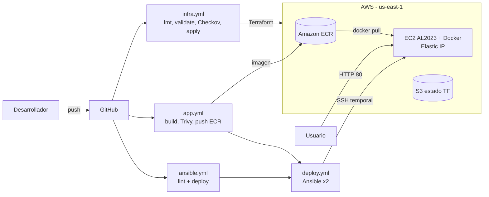

# -Aplicaci-n-Docker-administrada-con-Ansible-en-AWS_-Spiderman
 Taller 2: Aplicación Docker administrada con Ansible en AWS_ Spiderman
<<<<<<< HEAD
# Taller 2 – Aplicación Docker administrada con Ansible en AWS
# Grupo spiderman

**Asignatura:** Infraestructura para TI · **Equipo:** SPIDERMAN · **Proyecto:** `taller2-ansible-docker` · **Ambiente:** `dev`

Una aplicación web (Flask) se empaqueta en Docker, se publica en Amazon ECR y se ejecuta en una EC2 que **nadie configura a mano**: Terraform crea la infraestructura, Ansible instala Docker y despliega el contenedor, y GitHub Actions automatiza todo.

## 1. Arquitectura



| Recurso | Detalle |
|---|---|
| VPC + subred pública + IGW | Red dedicada |
| Security Group | 80 público; 22 **solo** `ADMIN_CIDR` (+ regla temporal del runner que se revoca) |
| EC2 `t3.micro` | AL2023, IMDSv2, disco cifrado gp3, Elastic IP |
| ECR | `scan_on_push`, conserva últimas 5 imágenes |
| IAM | Rol de la VM: solo lectura de ECR + SSM |
| S3 | Estado remoto de Terraform (versionado, cifrado) |
| OIDC | GitHub → AWS sin llaves estáticas |

## 2. Estructura del repositorio

```
app/          Flask + Dockerfile
terraform/    Infraestructura principal
bootstrap/    Estado remoto + OIDC (se ejecuta 1 vez, local)
ansible/      Playbook y roles (docker, webapp)
.github/workflows/  infra, app, ansible, deploy, security, destroy
```

## 3. Requisitos previos

- Cuenta AWS, AWS CLI configurado localmente (solo para el bootstrap)
- Terraform >= 1.10, Git, repositorio vacío en GitHub
- Una llave SSH dedicada: `ssh-keygen -t ed25519 -f taller2_key -N ""`

## 4. Despliegue paso a paso

### 4.1 Bootstrap (una sola vez)
```bash
cd bootstrap
terraform init
terraform apply \
  -var="github_repository=TU_USUARIO/TU_REPO" \
  -var="state_bucket_name=taller2-tfstate-TU_NOMBRE-12345"
# Si la cuenta ya tiene el OIDC de GitHub: -var="create_oidc_provider=false"
```
Anota las salidas `state_bucket` y `github_role_arn`.

### 4.2 Configurar GitHub (Settings → Secrets and variables → Actions)

**Variables** 
| Nombre | Valor |
|---|---|
| `AWS_REGION` | `us-east-1` |
| `AWS_ROLE_ARN` | salida `github_role_arn` |
| `TF_STATE_BUCKET` | salida `state_bucket` |
| `ADMIN_CIDR` | tu IP pública, ej. `190.1.2.3/32` |
| `BUDGET_EMAIL` | (opcional) correo para alertas de costo |

**Secrets**
| Nombre | Valor |
|---|---|
| `SSH_PUBLIC_KEY` | contenido de `taller2_key.pub` |
| `SSH_PRIVATE_KEY` | contenido de `taller2_key` |

### 4.3 Primer despliegue
1. Sube el código a `main`: el workflow **Infra (Terraform)** crea VPC, EC2, ECR, etc.
2. Ejecuta **App (build, Trivy, ECR y despliegue)** desde *Actions → Run workflow* (o haz un cambio en `app/`).
3. Abre `http://<IP_PUBLICA>` (aparece en el resumen del job *Infra* y *Deploy*).

## 5. Qué dispara cada workflow

| Cambio en | Workflow | Qué hace |
|---|---|---|
| `terraform/**` | `infra.yml` | fmt, validate, **Checkov**, plan y apply |
| `app/**` | `app.yml` → `deploy.yml` | build, **Trivy** (bloquea si HIGH/CRITICAL), push a ECR, Ansible actualiza el contenedor |
| `ansible/**` | `ansible.yml` → `deploy.yml` | ansible-lint y re-aplica la configuración |
| cualquier push | `security.yml` | **Trivy** sobre todo el repo (vuln, secretos, misconfig) |

## 6. Idempotencia (demostración requerida)
`deploy.yml` ejecuta el playbook **dos veces** y exige `changed=0` en la segunda (`grep "changed=0"`). Para mostrarlo en vivo:
```bash
gh workflow run deploy.yml -f image_tag=latest   # o desde la pestaña Actions
```
Descarga el artefacto `evidencia-ansible` (`ansible-run1.log` vs `ansible-run2.log`).

## 7. Demostración de cambios

| Demostración | Cómo hacerla | Evidencia |
|---|---|---|
| Cambio de aplicación | Edita el texto de `app/app.py`, haz push | Página muestra nuevo texto y nueva versión (SHA) |
| Cambio de infraestructura | En `terraform/variables.tf` cambia `root_volume_size` o agrega un tag, push | Artefacto `evidencia-terraform-apply` |
| Validación de seguridad | Pestaña Actions: Checkov (`evidencia-checkov`), Trivy (`evidencia-trivy-imagen`, `evidencia-trivy-repo`) | Artefactos descargables |
| Trivy bloqueando | Baja temporalmente `Flask` a una versión vulnerable y observa que el push a ECR NO ocurre | Job fallido |

## 8. Variables de Terraform
`region`, `project`, `environment`, `team`, `admin_cidr` (obligatoria, no admite `0.0.0.0/0`), `ssh_public_key` (obligatoria), `instance_type` (solo t3.micro/t3.small/t2.micro), `root_volume_size`, `vpc_cidr`, `budget_email`, `budget_limit_usd`.

## 9. Acceso
- Aplicación: `http://<IP>` · salud: `/health` · API: `/api/info`
- Administración: `ssh -i taller2_key ec2-user@<IP>` (solo desde `ADMIN_CIDR`) o AWS Systems Manager → Session Manager

## 10. Seguridad y costos
- Sin credenciales en el repo: OIDC + GitHub Secrets (solo la llave SSH).
- Tags en todo recurso: `Team`, `Project`, `Environment`.
- Contenedor sin root, IMDSv2, EBS cifrado, rol de VM con mínimo privilegio.
- Costos: instancia pequeña validada, ECR con política de retención, presupuesto con alerta (opcional), log rotation en Docker.

## 11. Destruir la infraestructura
Opción A (recomendada): *Actions → Destruir infraestructura → Run workflow* y escribe `DESTRUIR`.

Opción B (local):
```bash
cd terraform
terraform init -backend-config="bucket=<BUCKET>" -backend-config="region=us-east-1"
terraform destroy -var="admin_cidr=<IP>/32" -var="ssh_public_key=$(cat ../taller2_key.pub)"
```
Después, para borrar también el estado y el OIDC: vacía el bucket (incluidas versiones) y `cd bootstrap && terraform destroy ...`.

## 12. Registro de decisiones, limitaciones y mejoras
- **Amazon Linux 2023** por traer AWS CLI y soporte para ECR sin instalar extras.
- **SSH temporal desde el runner**: se abre solo la IP del runner durante el despliegue y se revoca siempre (`if: always()`); así el acceso permanente sigue limitado a la IP autorizada.
- **Tag `latest` mutable + tag SHA**: `latest` permite re-aplicar configuración; el SHA da trazabilidad. Checkov `CKV_AWS_51` se omite con justificación.
- **Checkov skips documentados** en el código (subred pública, flow logs, KMS propio) para limitar costos.
- **Limitaciones:** una sola instancia (sin alta disponibilidad), HTTP sin TLS, `host_key_checking=False` en CI, el rol de CI usa `ec2:*` acotado por región.
- **Mejoras:** ALB + HTTPS (ACM), Auto Scaling, rollback automático, Session Manager en lugar de SSH, restringir el `sub` del OIDC a `ref:refs/heads/main`.

## 13. Lista de evidencias para entregar
- [ ] URL del repositorio y de la aplicación
- [ ] Capturas de Actions (infra, app, ansible, security) en verde
- [ ] Artefactos: Checkov, Trivy imagen, Trivy repo, Ansible (2 corridas, `changed=0`), Terraform apply
- [ ] Captura de ECR con la imagen y de la EC2 con tags
- [ ] Cambio de app desplegado + cambio de infra aplicado
- [ ] Captura del destroy
=======
# -Aplicaci-n-Docker-administrada-con-Ansible-en-AWS_-Spiderman
 Taller 2: Aplicación Docker administrada con Ansible en AWS_ Spiderman
>>>>>>> 324371f37e48b81f4af9044b86f7793469a77698
